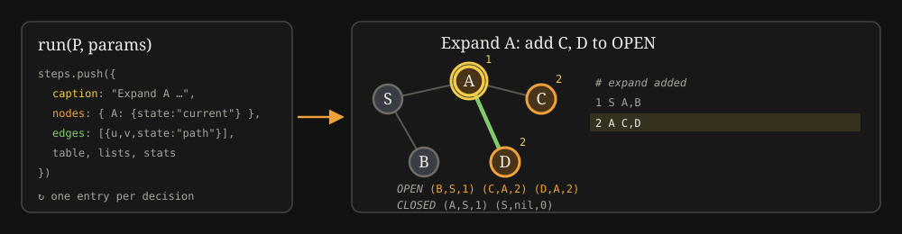
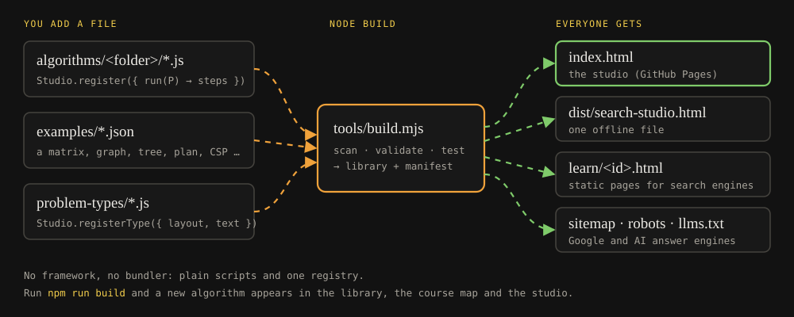

<p align="center">
  <a href="https://1mystic.github.io/search-studio/"></a>
</p>

<p align="center">
  <a href="https://1mystic.github.io/search-studio/"><b>Open the studio</b></a> ·
  <a href="https://1mystic.github.io/search-studio/#library">Learn</a> ·
  <a href="https://1mystic.github.io/search-studio/#course">Course map</a> ·
  <a href="CONTRIBUTING.md">Contribute</a>
  <br>
  
  
  
</p>

# Search Studio

A free, open, **step-by-step visual studio for classical AI search algorithms**, written in the notation of
*AI: Search Methods for Problem Solving* (NPTEL · IIT Madras · Prof. Deepak Khemani).
Every decision an algorithm makes — what it picks from OPEN, what goes on CLOSED, which move it accepts, which branch it prunes — is on screen.

- **Learn** each algorithm before running it: a beginner introduction, a definition, pseudocode explained line by line, the formulas and *why* they hold, properties, and exam traps.
- **Run** it on worked examples, on a random problem from a seed, or on your own matrix, graph, game tree or constraint problem.
- **Step** through the drawing, the working table and the OPEN/CLOSED rows; play, pause, scrub, or jump from the trace.
- **Export** a print-ready trace (a cover page plus one step per page), trace JSON/CSV, the current step as SVG, or the problem as JSON.

Light and dark themes, keyboard friendly (`/` finds an algorithm, `←` `→` step, `Space` plays), works offline as a single HTML file.

## What one step looks like

<p align="center"></p>

## The catalogue, by week

| Week | Algorithms |
|:--:|---|
| 1 | Introduction: the Turing Test, the Winograd Schema Challenge (reading only) |
| 2 | Breadth First Search · Depth First Search · Depth First Iterative Deepening |
| 3 | Best First Search · Hill Climbing · Beam Search · TSP: Nearest Neighbour · Greedy · Savings · Brute force · 2-city exchange · 2-opt · Or-opt · 3-edge exchange · VND · Beam search · Tabu search · Iterated hill climbing · Random walk · Simulated annealing |
| 4 | Genetic algorithm · Crossover lab (CX, PMX, OX, AEX, HX, ordinal) · Ant colony optimisation |
| 5 | Uniform Cost Search · A* |
| 6 | Admissibility & monotone check · IDA* · RBFS · Divide & Conquer Frontier Search · Sequence alignment (DP and A*) |
| 7 | Minimax · Alpha-Beta pruning · SSS* |
| 8 | Forward and backward state-space planning · Goal Stack Planning · Partial Order Planning |
| 9 | AO* on AND–OR graphs |
| 10 | Forward chaining · Rete |
| 11 | Backtracking · Forward checking · Arc consistency (AC-1, AC-3) · Waltz labelling · Model-based diagnosis |

Conventions used everywhere: OPEN and CLOSED hold node pairs `(node, parent, depth or g)`, ties break alphabetically, the goal test happens when a node is *picked* from OPEN, simulated annealing accepts a worse move with probability `1 / (1 + e^(−ΔE/T))`, and savings are `S(i,j) = C(b,i) + C(b,j) − C(i,j)`.

## Quick start

```bash
git clone https://github.com/1mystic/search-studio && cd search-studio
npm run build     # validate + test + build (Node 18+, no npm install needed)
npm run serve     # then open the printed localhost address
# or just open dist/search-studio.html: the whole site in one file
```

`npm run watch` rebuilds whenever a file in `algorithms/`, `examples/`, `problem-types/` or `src/` changes.

## How it is built

<p align="center"></p>

```
algorithms/<folder>/*.js   one algorithm per file: Studio.register({ id, name, week, learn, params, run })
problem-types/*.js         drawing + text format for each kind of problem (TSP, graph, game, plan, CSP, …)
examples/*.json            worked problems shown in the problem picker
src/core, src/ui           registry, search engine, renderer, app
tools/build.mjs            scan → validate → test → index.html, dist/, learn/, sitemap.xml, llms.txt
tools/test.mjs             known answers from the course (BFS order, A* cost, minimax value, plans, …)
```

There is no framework and no bundler. Drop a file in a folder, run the build, and it appears in the library, the course map and the studio.

## Search and AI discoverability

The build writes, from the same registry the site uses: full meta and Open Graph tags, JSON-LD (`WebSite`, `WebApplication`, `LearningResource`, `ItemList`), one static crawlable page per algorithm in `learn/`, `sitemap.xml`, a `robots.txt` that welcomes search and AI crawlers, and `llms.txt` / `llms-full.txt` summaries for answer engines. Set `SITE_URL` (or `homepage` in `package.json`) before building if you host it elsewhere.

## Contributing

New algorithms, examples, problem types, fixes and translations are all welcome. See **[CONTRIBUTING.md](CONTRIBUTING.md)** — the short version is: copy `algorithms/_template.js`, fill it in, run `npm run build`.

## License

Public domain under **[The Unlicense](LICENSE)**. Copy it, change it, sell it, teach with it, no attribution required.

Search Studio is an independent study aid and is not affiliated with IIT Madras or NPTEL.

<p align="center"><sub>made by <a href="https://github.com/1mystic">1mystic</a></sub></p>
